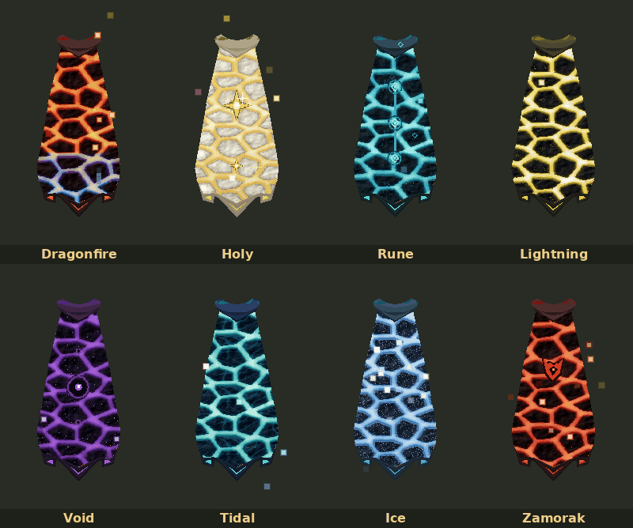
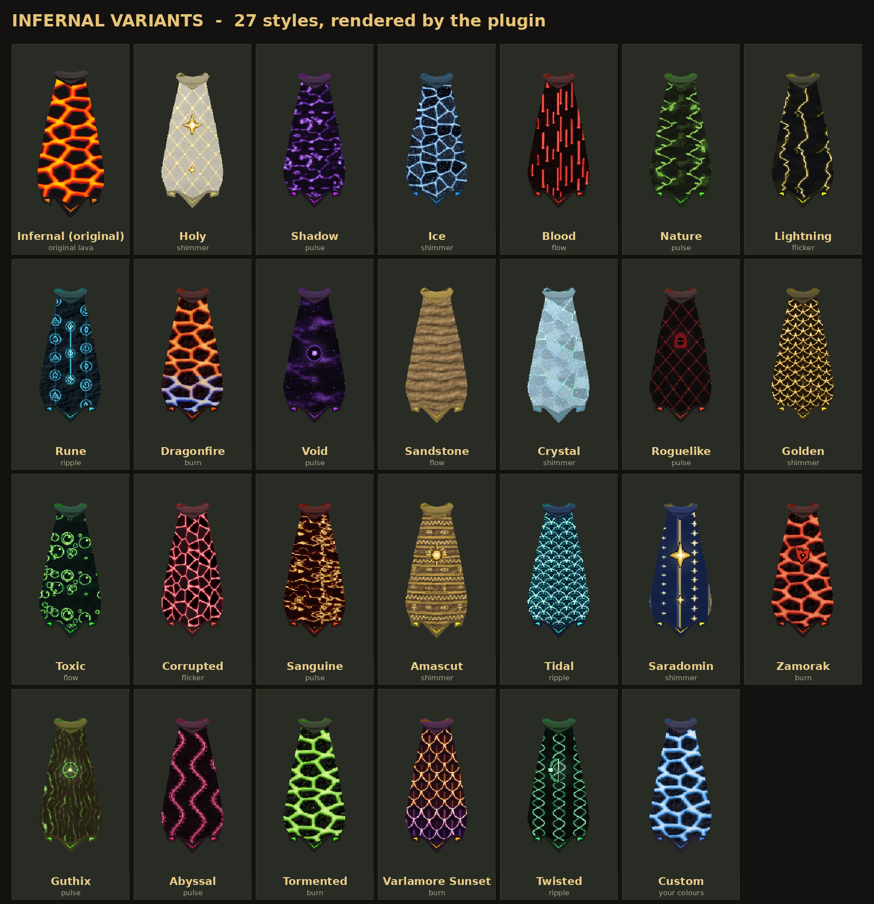
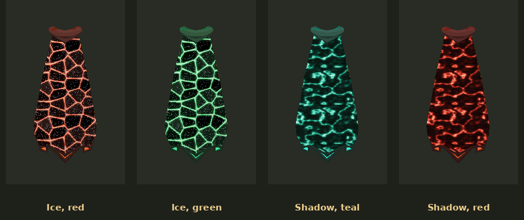

# Infernal Variants

Repaint your infernal cape in 17 designs, or recolour any of them yourself. Several keep the real cape's crack pattern with their own touches (blood running off the veins, leaves growing over them, lightning flashing across them); Ice, Shadow, Crystal and Holy have their own designs; and everything flows down the cape.

| Style | Look |
|---|---|
| Infernal (original) | Untouched lava |
| Holy | Ivory feathers with gold seams and studs down the centre, gold collar and hem, holy star emblems |
| Shadow | Drifting purple smoke wisps on black |
| Ice | Shattered ice shards with frosted edges |
| Blood | The infernal cracks in deep red, with blood running off the veins |
| Nature | The infernal cracks in green, overgrown with leaves along the glowing veins |
| Lightning | The infernal cracks in electric yellow, with forked bolts flashing across the stone |
| Rune | Dark teal scales with a glowing channel and rune circles down the centre |
| Void | Purple channel down the centre with the void eye emblem |
| Sandstone | Weathered sandstone scales |
| Crystal | Shattered crystal shards, each its own pale colour, with bright rims and dark fractures |
| Corrupted | Jagged red crystal splinters |
| Sanguine | Branching gold-and-blood vessels |
| Amascut | Desert bands of zigzags, sun discs, ankhs and eyes, sun emblem |
| Guthix | Flowing wood grain with knots, balance emblem |
| Tormented | Demon-green fire cracks with sparks |
| Varlamore Sunset | Sunbird feathers fading from orange to dusk purple |
| Custom | Any design (Ice shards, Shadow smoke or any other) in your own colours |

## Settings
- **Cape style** — pick the design.
- **Custom style** — set Cape style to Custom, pick a design (Ice, Shadow or any other) and choose its base, line and glow colours. The design keeps its pattern, motion and emblems.
- **Animated veins** — each style has its own motion (see below).
- **Emblems** — toggle the style emblems.
- **Include infernal max cape** — also repaint the infernal max cape.
- **Other players' capes** — Off, Same style, or Random per player (stable per name).

## Motion
On every style the veins flow down the cape, each at its own pace, with a glow that moves in its own way:
- **Flow** — a steady downward drift with a gentle glow (Blood, Sandstone).
- **Pulse** — the glow swells and fades (Shadow, Void, Nature, Sanguine, Guthix).
- **Flicker** — irregular electric crackle with sudden surges (Corrupted; Lightning also throws bolts across the stone).
- **Shimmer** — a band of light sweeps from collar to hem (Holy, Ice, Crystal, Amascut).
- **Ripple** — soft waves travel down the cape (Rune).
- **Burn** — uneven firelight, hottest at the hem (Tormented, Varlamore Sunset).

Emblems glow softly and breathe with the veins.

## Art details
- Every pattern is drawn to look right when worn: the cape stretches its texture, so round motifs are pre-shaped to stay round.
- Each pattern sits on its own material: lit rock (the crack styles), small lit scales (Rune, Void, Sandstone), flat crystal faces (Ice, Crystal, Corrupted) or soft surfaces (Shadow, Holy).
- The glowing lines are two-tone: a hot core plus a glow that spills onto the surface in a second colour.

## How it works
The game can't recolour a texture, and the cape's outer panel is a single lava texture. Each frame the plugin reads your animated model, finds the faces using that texture, computes their texture coordinates the same way the client does, and draws a repainted version of the texture onto them — so the design moves with the cape. The crack pattern is taken from the game's own texture at runtime and the other patterns are generated in code; nothing from the game cache is bundled. The rock trim, hem accents and inner lining are recoloured through the client's per-player colour overrides.

All changes are client-side; only you see them.

## Known limits
- The design is drawn over the finished frame, so the plugin works out per pixel what's in front of the cape (your own arms and weapon, pets, other players, NPCs, scenery) and leaves those visible. Very thin or see-through objects may not always cover it exactly.
- Emblems are placed for the standard infernal cape; the infernal max cape gets the repaint and effects without emblems.
